<a href="https://github.com/PatterAI/Patter"></a>

I'm building **[Patter](https://github.com/PatterAI/Patter)**, the open-source voice AI SDK that gives your AI agent a phone number in 4 lines of code. Python and TypeScript, MIT licensed, and it runs on Twilio, Telnyx, and Plivo. Patter is the Vapi and Retell alternative for builders who want to own the stack.

```bash
pip install getpatter
npm install getpatter
```

[Docs](https://docs.getpatter.com) · [getpatter.com](https://getpatter.com) · [Star Patter on GitHub](https://github.com/PatterAI/Patter)

## Lines



**Patter line**

- **[Patter](https://github.com/PatterAI/Patter)**: the SDK. Give your AI agent a phone number.
- **[awesome-claude-call](https://github.com/PatterAI/awesome-claude-call)**: give Claude Code a phone number. Outbound, inbound, and ring-when-done calls, as a Claude Code plugin.
- **[patter-mcp](https://github.com/PatterAI/patter-mcp)**: MCP server for Patter. Make and receive calls from Claude Code, Cursor, ChatGPT, Codex, and any MCP client.
- **[skills](https://github.com/PatterAI/skills)**: Agent Skills for Patter. `npx skills add patterai/skills`

**Tools line**

- **[e2e-bughunt](https://github.com/FrancescoRosciano/e2e-bughunt)**: autonomous, evidence-first end-to-end bug hunting for Claude Code.
- **[bugpin](https://github.com/FrancescoRosciano/bugpin)**: Chrome extension. Point at an element, say what's wrong, and export console, network, repro steps, and screenshots as one folder.
